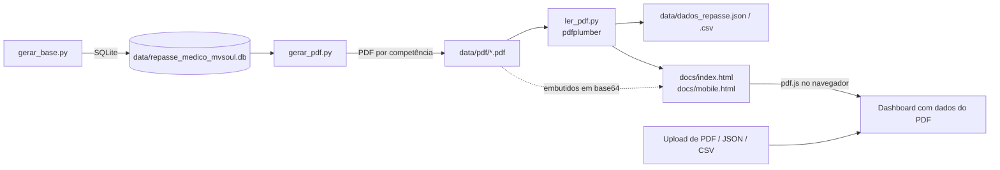

# 🩺 Repasse Médico — base fictícia inspirada no modelo de relatório MV + Dashboard

Projeto 100% em **Python** (bibliotecas padrão + `reportlab` e `pdfplumber`) que simula o ciclo de
**repasse médico** de um hospital. O layout do relatório e a organização dos dados foram **inspirados no modelo de
relatório de Repasse Médico do MV** (sistema MV Soul, módulo *Custos / Repasse Médico*):

1. **gera** uma base de dados fictícia (SQLite) com médicos, especialidades, convênios, regras de repasse e
   lançamentos apropriados por **centro de custo**;
2. **emite** o *Demonstrativo de Repasse Médico* em **PDF** (um relatório por competência, uma seção por médico);
3. **lê** esse PDF de volta e extrai os lançamentos (JSON/CSV);
4. **publica** dois dashboards HTML dinâmicos — **desktop** e **smartphone** — que já abrem carregando os PDFs de exemplo.

> ℹ️ **Inspiração:** o demonstrativo em PDF segue a ideia do **modelo de relatório de Repasse Médico do MV**
> (cabeçalho do prestador, lançamentos por atendimento/procedimento, apropriação por centro de custo e totais).
> É uma recriação própria, feita só para estudo e demonstração.
>
> ⚠️ **Todos os dados são fictícios.** Este projeto é independente e **não tem vínculo, afiliação ou aprovação da
> MV Informática**; “MV” e “MV Soul” são marcas de seu titular, citadas apenas para indicar a inspiração.

---

## Demonstração

Com o repositório publicado, ative o **GitHub Pages** (*Settings → Pages → Branch `main` → pasta `/docs`*):

| Versão | Arquivo | Link (após ativar o Pages) |
|---|---|---|
| Desktop | `docs/index.html` | `https://SEU-USUARIO.github.io/repasse-medico-mvsoul/` |
| Smartphone | `docs/mobile.html` | `https://SEU-USUARIO.github.io/repasse-medico-mvsoul/mobile.html` |

Ou apenas baixe o repositório e abra `docs/index.html` no navegador (é um arquivo único, sem servidor).

## Arquitetura



## Estrutura de pastas

```
repasse-medico-mvsoul/
├── run_all.py                 # executa o pipeline completo (1 comando)
├── requirements.txt           # pdfplumber, reportlab
├── src/
│   ├── gerar_base.py          # 1) cria o banco SQLite fictício (layout MV Soul)
│   ├── gerar_pdf.py           # 2) emite o Demonstrativo de Repasse Médico em PDF
│   ├── ler_pdf.py             # 3) lê o PDF → JSON/CSV e monta os dashboards
│   └── templates/
│       ├── dashboard_desktop.html   # modelo do dashboard desktop
│       └── dashboard_mobile.html    # modelo do dashboard mobile
├── data/
│   ├── repasse_medico_mvsoul.db     # base gerada
│   ├── pdf/                         # PDFs de exemplo (jul, ago, set/2026)
│   ├── dados_repasse.json           # lançamentos extraídos dos PDFs
│   └── dados_repasse.csv            # idem, em CSV (separador ;)
├── docs/
│   ├── index.html                   # dashboard desktop (pronto, com PDFs embutidos)
│   ├── mobile.html                  # dashboard smartphone
│   └── DICIONARIO_DE_DADOS.md       # tabelas e colunas
└── tests/
    └── test_leitura_pdf.py          # PDF lido == banco (quantidade e valores)
```

## Como executar

Requer **Python 3.9+**.

```bash
pip install -r requirements.txt
python run_all.py          # gera base → PDFs → leitura → dashboards em docs/
python -m unittest discover -s tests -v   # opcional: confere PDF x banco
```

Cada etapa também roda isolada:

```bash
python src/gerar_base.py                 # só a base SQLite
python src/gerar_pdf.py 2026-09          # PDF de uma competência (ou: todas)
python src/ler_pdf.py meu_demonstrativo.pdf   # lê PDFs específicos
```

A semente aleatória é fixa: toda execução produz **os mesmos dados** (642, 697 e 683 lançamentos em jul, ago e set/2026).

## O que a base contém

40 médicos · 10 especialidades · 6 convênios · 8 centros de custo · ~2.000 lançamentos de repasse por trimestre.
Detalhes de cada tabela em [`docs/DICIONARIO_DE_DADOS.md`](docs/DICIONARIO_DE_DADOS.md).

**Regras de cálculo usadas na simulação**

| Item | Regra |
|---|---|
| Repasse do lançamento | `valor da conta × % de repasse` (% por convênio: Unimed 62, Bradesco 60, SulAmérica 58, Amil 60, SUS 45, Particular 75) |
| Glosa | desconto sobre o repasse de parte dos lançamentos |
| Impostos retidos | 11,75% sobre (repasse − glosa) — valor fictício |
| Repasse líquido | `repasse − glosa − impostos` |
| Apropriação | cada lançamento carrega o **centro de custo** (Centro Cirúrgico, UTI, Hemodinâmica, etc.) |

## O PDF (Demonstrativo de Repasse Médico, inspirado no modelo MV)

- Página 1: resumo da competência por **centro de custo** e por **especialidade**.
- Uma seção por médico: cabeçalho (prestador, CRM, especialidade, vínculo, nº do repasse), lista de lançamentos
  (atendimento, paciente, procedimento, convênio, valor da conta, % e valor do repasse, glosa, centro de custo),
  quadro de **apropriação por centro de custo** e totais (bruto, glosas, impostos, líquido).

## Os dashboards

Arquivo único, sem servidor. Abrem **já carregados** com os PDFs de exemplo (embutidos em base64 e lidos no
navegador com [pdf.js](https://mozilla.github.io/pdf.js/)).

| Aba | O que faz |
|---|---|
| **1 · Dashboard** | indicadores, repasse líquido por especialidade, evolução por competência, centro de custo, convênio, visão por médico e lançamentos. Filtros dinâmicos: toque/clique em barras, fatias ou médicos. |
| **2 · Carga de arquivos** | envia **PDF** (mesmo formato do demonstrativo), **JSON** ou **CSV** para atualizar a base — modo *atualizar* (acrescenta novos e substitui lançamentos iguais) ou *substituir*. |
| **3 · Regras por procedimento** | matriz de % de repasse por procedimento × convênio (lida dos lançamentos). Edite os valores e ative **“Aplicar regras”** para simular o repasse no painel. |

A versão **mobile** (`docs/mobile.html`) usa barra de navegação inferior, painel de filtros em folha deslizante,
listas em cartões e ajuste das regras com botões **− / +**.

Se a leitura do PDF no navegador falhar (ex.: sem internet para carregar o pdf.js), o painel usa os dados extraídos
pelo Python a partir dos mesmos PDFs e avisa na aba *Carga*.

## Formato do CSV/JSON (para a aba Carga)

Colunas: `rep, cd_med, med, crm, esp, vinc, comp, atend, pac, dt, cod, proc, conv, tp, vl_conta, pc, vl_rep, glosa, cc, cc_ds`
(descrição no [dicionário de dados](docs/DICIONARIO_DE_DADOS.md)).

## Limitações conhecidas

- O leitor de PDF foi escrito para **o layout deste demonstrativo** (colunas de largura fixa). PDFs reais do MV Soul têm
  outro formato e exigiriam ajustar `ler_pdf.py` e o leitor do template.
- As “regras de repasse” do dashboard são **inferidas** do % predominante nos lançamentos; não vêm de um cadastro oficial.
- Impostos e percentuais são ilustrativos, não refletem tributação real.

## Ideias de evolução

- Rateio de um mesmo lançamento entre vários centros de custo.
- Filtro por período livre e exportação do que está filtrado.
- Cadastro de regras com vigência (data inicial/final) e prioridade por convênio/procedimento.
- Integração com banco real (Oracle) via camada de leitura configurável.

## Licença

[MIT](LICENSE) — dados fictícios, uso livre para estudo e demonstração.
